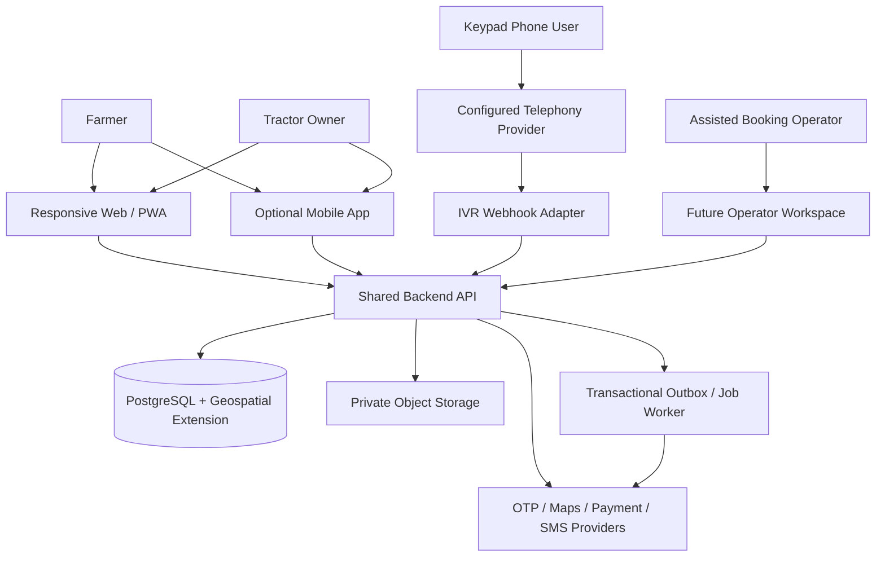
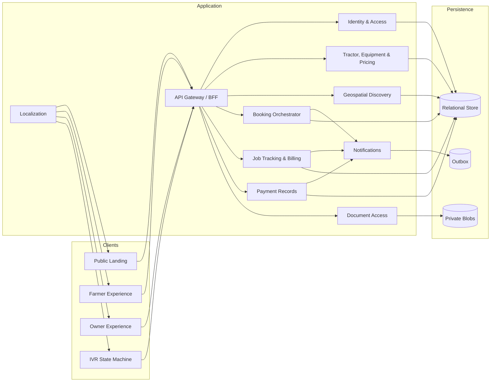
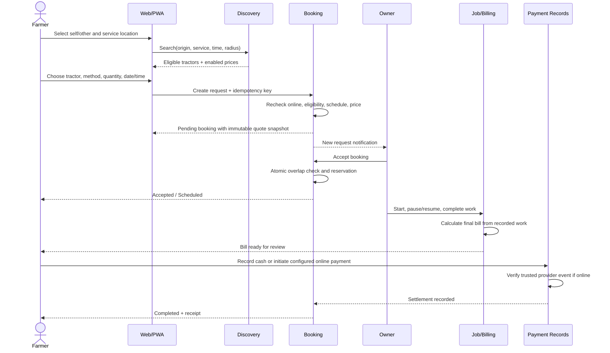
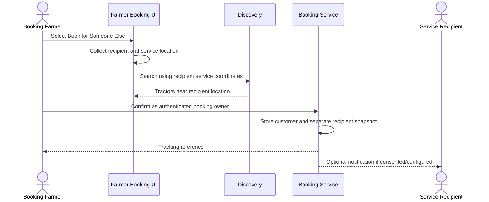

# Design Document: KisanTractor Platform

## Overview

KisanTractor is a multi-channel tractor-service marketplace for Indian farmers and tractor owners. A responsive web/PWA, optional mobile client, and future IVR channel share one backend so identity, location, tractor availability, booking, agreed pricing, work evidence, billing, and payment records remain consistent.

The design follows the supplied green-and-cream agricultural showcase: large labeled controls, mobile-first cards, explicit role dashboards, a prominent owner online/offline control, simple booking steps, and a desktop landing page with progressive 3D enhancement. Reliable booking ships before production external-provider integrations and premium 3D. Unconfigured OTP, maps, payments, SMS, storage, or IVR capabilities are visibly unavailable or use an explicitly labeled local sandbox; the product never simulates a live provider.

Release boundaries are capability-gated rather than visual-only. Phase 1 delivers the core booking platform with local/development adapters and manual location support; Phase 2 enables configured payment and communication providers; Phase 3 enables configured IVR; Phase 4 adds premium 3D and advanced discovery/analytics without coupling them to booking.

## Architecture

### System Context



### Logical Containers



The initial deployment is a modular monolith with separately owned modules and one relational database. This avoids distributed transaction complexity while preserving boundaries that can later be extracted. All state-changing requests pass through server-side authorization, validation, idempotency, and audit recording. Domain events are written to a transactional outbox and delivered asynchronously.

### Main Booking Sequence



### Booking for Someone Else Sequence



## Components and Interfaces

### Client Shell and Role Navigation

**Purpose:** Provides responsive routing, localization, offline-aware PWA behavior, accessible controls, and role-specific navigation in one product.

```pascal
INTERFACE ClientShell
  PROCEDURE StartSession(accessToken, preferredLocale)
  PROCEDURE SelectActiveRole(role)
  PROCEDURE Navigate(route)
  FUNCTION CapabilityState(capabilityName) RETURNS CapabilityPresentation
  PROCEDURE QueueSafeDraft(draft)
END INTERFACE
```

**Responsibilities:**
- Farmer navigation: Home, Search, Bookings, Help, Account.
- Owner navigation: Dashboard, My Tractors, Bookings, Earnings, Account.
- Prevent route rendering when the authenticated role lacks permission.
- Cache only non-sensitive shell assets and explicitly safe drafts; never cache identity tokens, private documents, or payment responses in a public cache.
- Show offline/read-only and provider-unavailable states instead of dead controls.

### Identity and Access Module

```pascal
INTERFACE IdentityService
  FUNCTION RequestOtp(phone, purpose, locale) RETURNS OtpChallengeResult
  FUNCTION VerifyOtp(challengeId, code) RETURNS AuthSession
  FUNCTION RefreshSession(refreshCredential) RETURNS AuthSession
  PROCEDURE RevokeSession(sessionId)
  FUNCTION Authorize(principal, action, resource) RETURNS AuthorizationDecision
END INTERFACE
```

**Responsibilities:** Normalize Indian mobile numbers, enforce challenge expiry and attempt/request limits, bind a challenge to purpose and phone, issue short-lived access credentials, support Farmer and Owner memberships, and log sensitive actions. A local OTP adapter may reveal a test code only in an explicitly labeled non-production environment.

### Catalog and Owner Operations Module

```pascal
INTERFACE CatalogService
  FUNCTION RegisterTractor(ownerId, tractorDraft) RETURNS Tractor
  FUNCTION UpdateTractor(ownerId, tractorId, patch, expectedVersion) RETURNS Tractor
  FUNCTION AttachEquipment(ownerId, tractorId, equipmentId) RETURNS TractorEquipment
  FUNCTION ConfigurePricing(ownerId, serviceOfferingId, rules) RETURNS PricingRuleSet
  FUNCTION SetOperationalStatus(ownerId, tractorId, status) RETURNS TractorAvailability
  FUNCTION IssueDocumentUpload(ownerId, documentMetadata) RETURNS PrivateUploadGrant
END INTERFACE
```

A tractor becomes discoverable only when ownership, required fields, service offerings, active pricing, location freshness, document policy, and online status pass eligibility checks. Existing accepted bookings remain manageable after the owner or tractor goes offline.

### Geospatial Discovery Module

```pascal
INTERFACE DiscoveryService
  FUNCTION SearchTractors(query, principal) RETURNS PagedSearchResult
  FUNCTION ResolveManualLocation(addressParts) RETURNS LocationResolution
  FUNCTION EstimateDistance(origin, tractorLocation) RETURNS DistanceEstimate
END INTERFACE

STRUCTURE DiscoveryQuery
  serviceLocation: GeoPoint
  administrativeArea: AddressParts
  radiusKilometers: Decimal
  serviceId: Identifier
  equipmentTypeId: Optional Identifier
  requestedInterval: TimeInterval
  pricingMethod: Optional PricingMethod
  pageCursor: Optional String
END STRUCTURE
```

The server treats the service location as the sole search origin. Exact recipient/customer coordinates and owner contact details are redacted from public result cards. If map/geocoding is unconfigured, manual administrative location and coordinates supplied through an approved development fixture remain available and clearly labeled.

### Booking Module

```pascal
INTERFACE BookingService
  FUNCTION CreateBooking(customerId, command, idempotencyKey) RETURNS Booking
  FUNCTION AcceptBooking(ownerId, bookingId, expectedVersion) RETURNS Booking
  FUNCTION RejectBooking(ownerId, bookingId, reason, expectedVersion) RETURNS Booking
  FUNCTION CancelBooking(actor, bookingId, reason, expectedVersion) RETURNS Booking
  FUNCTION Transition(actor, bookingId, targetStatus, evidence, expectedVersion) RETURNS Booking
  FUNCTION GetBooking(principal, bookingId) RETURNS BookingView
END INTERFACE
```

CreateBooking re-reads tractor/service/pricing data, validates availability, stores an immutable quote snapshot, and records customer plus optional recipient. AcceptBooking serializes acceptance per tractor and rejects schedule overlap atomically.

### Job Tracking and Billing Module

```pascal
INTERFACE JobBillingService
  FUNCTION StartJob(ownerId, bookingId, occurredAt, idempotencyKey) RETURNS WorkSession
  FUNCTION PauseJob(ownerId, bookingId, occurredAt, idempotencyKey) RETURNS WorkSession
  FUNCTION ResumeJob(ownerId, bookingId, occurredAt, idempotencyKey) RETURNS WorkSession
  FUNCTION CompleteJob(ownerId, bookingId, completionInput, idempotencyKey) RETURNS Invoice
  FUNCTION ReviewInvoice(customerId, invoiceId, decision, note) RETURNS Invoice
  FUNCTION RecalculateDraft(bookingId, workEvidence) RETURNS Money
END INTERFACE
```

All authoritative timestamps are server-received timestamps with optional device-observed metadata. Corrections require a reason and create an audit event; they do not overwrite history. Hourly work sums non-overlapping active intervals and applies only the snapshotted rounding rule.

### Payment Record Module

```pascal
INTERFACE PaymentService
  FUNCTION RecordCash(actor, invoiceId, amount, receivedAt, idempotencyKey) RETURNS Payment
  FUNCTION CreateOnlineIntent(customerId, invoiceId, provider) RETURNS PaymentIntentResult
  FUNCTION HandleProviderEvent(provider, signedEvent) RETURNS ProviderEventResult
  FUNCTION GetReceipt(principal, paymentId) RETURNS Receipt
  FUNCTION InitiateRefund(actor, paymentId, amount, reason) RETURNS RefundResult
END INTERFACE
```

Browser redirects never mark an online payment paid. Only a verified, deduplicated provider event can do so. Cash records identify the recorder and remain distinct from online settlement.

### Provider Capability Registry

```pascal
INTERFACE CapabilityRegistry
  FUNCTION GetState(capability) RETURNS CapabilityState
  FUNCTION RequireConfigured(capability) RETURNS ProviderHandle OR CapabilityUnavailable
END INTERFACE

ENUM CapabilityState
  UNCONFIGURED
  SANDBOX
  LIVE
  DEGRADED
END ENUM
```

Every provider-backed entry point reads this registry. `UNCONFIGURED` disables submission and explains setup; `SANDBOX` is visibly labeled; `DEGRADED` offers retry or a safe manual alternative where permitted; only `LIVE` claims production delivery.

### IVR Adapter

```pascal
INTERFACE IvrBookingAdapter
  FUNCTION BeginCall(providerCallId, callerNumber) RETURNS IvrPrompt
  FUNCTION HandleDigits(sessionId, promptVersion, digits) RETURNS IvrPrompt
  FUNCTION ConfirmIdentity(sessionId, verificationInput) RETURNS IvrPrompt
  FUNCTION SubmitBooking(sessionId, idempotencyKey) RETURNS IvrBookingResult
  FUNCTION GetBookingStatus(sessionId, bookingReference) RETURNS IvrPrompt
END INTERFACE
```

IVR commands invoke the same application services as web/PWA. Prompt trees are versioned and localized; retries are bounded; sensitive booking access requires caller verification. The public site does not show a phone number until the telephony capability is live.

## Data Models

### Core Enumerations

```pascal
ENUM UserRole
  FARMER
  OWNER
  FUTURE_OPERATOR
END ENUM

ENUM PricingMethod
  HOURLY
  PER_ACRE
  PER_TRIP
END ENUM

ENUM RoundingPolicy
  PROPORTIONAL_MINUTE
  THIRTY_MINUTE_BLOCK
  ONE_HOUR_BLOCK
END ENUM

ENUM BookingStatus
  CREATED
  PENDING_OWNER_RESPONSE
  ACCEPTED
  SCHEDULED
  IN_PROGRESS
  WORK_COMPLETED
  FINAL_BILL_GENERATED
  PAYMENT_RECORDED
  COMPLETED
  REJECTED
  CANCELLED
  EXPIRED
  DISPUTED
  REFUND_PENDING
  REFUNDED
END ENUM

ENUM PaymentStatus
  PENDING
  AWAITING_FINAL_BILL
  PAYMENT_DUE
  PAID_ONLINE
  PAID_CASH
  PAYMENT_FAILED
  REFUND_PENDING
  REFUNDED
END ENUM
```

### Identity and Profiles

```pascal
STRUCTURE User
  id: Identifier
  normalizedPhone: EncryptedString
  phoneLookupHash: String
  status: AccountStatus
  createdAt: Instant
  deletedAt: Optional Instant
END STRUCTURE

STRUCTURE RoleMembership
  userId: Identifier
  role: UserRole
  grantedAt: Instant
END STRUCTURE

STRUCTURE UserProfile
  userId: Identifier
  fullName: String
  preferredLocale: LocaleCode
  contactSharingConsent: Boolean
  defaultLocationId: Optional Identifier
END STRUCTURE

STRUCTURE OwnerProfile
  userId: Identifier
  operatingLocationId: Identifier
  verificationStatus: VerificationStatus
END STRUCTURE
```

**Validation rules:** normalized phones are unique among active accounts; names support Unicode; locale falls back to English; role membership is explicit and never inferred from a route.

### Location, Tractor, Equipment, and Pricing

```pascal
STRUCTURE Location
  id: Identifier
  coordinates: Optional GeoPoint
  state: String
  district: String
  mandalOrTaluk: String
  village: String
  postalCode: Optional String
  landmark: Optional String
  source: LocationSource
  accuracyMeters: Optional Decimal
  capturedAt: Instant
END STRUCTURE

STRUCTURE Tractor
  id: Identifier
  ownerId: Identifier
  brand: String
  model: String
  registrationNumberCiphertext: EncryptedString
  registrationLookupHash: String
  manufacturingYear: Integer
  horsepower: Optional Decimal
  operationalStatus: OperationalStatus
  eligibilityStatus: EligibilityStatus
  currentLocationId: Identifier
  locationUpdatedAt: Instant
  version: Integer
END STRUCTURE

STRUCTURE Equipment
  id: Identifier
  ownerId: Identifier
  typeId: Identifier
  displayName: String
  availabilityStatus: AvailabilityStatus
END STRUCTURE

STRUCTURE ServiceOffering
  id: Identifier
  tractorId: Identifier
  serviceId: Identifier
  equipmentId: Optional Identifier
  enabled: Boolean
END STRUCTURE

STRUCTURE PricingRule
  id: Identifier
  serviceOfferingId: Identifier
  method: PricingMethod
  rateMinorUnits: Integer
  currency: CurrencyCode
  roundingPolicy: Optional RoundingPolicy
  minimumQuantity: Optional Decimal
  validFrom: Instant
  validTo: Optional Instant
  version: Integer
END STRUCTURE
```

**Validation rules:** rates are positive integer minor units; hourly rules require a disclosed rounding policy; non-hourly rules do not use time rounding; only enabled, currently valid rules are selectable; registration number is owner/private-support visible only; geospatial coordinates use a consistent spatial reference.

### Booking and Immutable Agreement

```pascal
STRUCTURE Booking
  id: Identifier
  reference: PublicReference
  customerId: Identifier
  ownerId: Identifier
  tractorId: Identifier
  serviceOfferingId: Identifier
  serviceLocationSnapshot: LocationSnapshot
  recipient: Optional RecipientSnapshot
  requestedInterval: TimeInterval
  expectedQuantity: Optional Decimal
  status: BookingStatus
  quoteSnapshot: QuoteSnapshot
  version: Integer
  createdAt: Instant
END STRUCTURE

STRUCTURE RecipientSnapshot
  name: String
  phoneCiphertext: Optional EncryptedString
  phoneLookupHash: Optional String
  coordinationConsent: Boolean
END STRUCTURE

STRUCTURE QuoteSnapshot
  pricingRuleId: Identifier
  pricingRuleVersion: Integer
  method: PricingMethod
  rateMinorUnits: Integer
  currency: CurrencyCode
  roundingPolicy: Optional RoundingPolicy
  estimatedQuantity: Decimal
  estimatedTotalMinorUnits: Integer
  disclosedAt: Instant
END STRUCTURE

STRUCTURE BookingStatusEvent
  id: Identifier
  bookingId: Identifier
  fromStatus: Optional BookingStatus
  toStatus: BookingStatus
  actorId: Optional Identifier
  actorChannel: Channel
  reason: Optional String
  occurredAt: Instant
END STRUCTURE
```

The quote snapshot is append-only after confirmation. Any mutually agreed change creates a new agreement version, retains prior versions, and notifies both parties. The authenticated farmer remains `customerId` even when `recipient` is present.

### Work, Invoice, and Payment

```pascal
STRUCTURE WorkEvent
  id: Identifier
  bookingId: Identifier
  eventType: WorkEventType
  effectiveAt: Instant
  receivedAt: Instant
  actorId: Identifier
  correctionOf: Optional Identifier
  reason: Optional String
END STRUCTURE

STRUCTURE WorkMeasurement
  id: Identifier
  bookingId: Identifier
  method: PricingMethod
  quantity: Decimal
  unit: MeasurementUnit
  submittedBy: Identifier
  createdAt: Instant
END STRUCTURE

STRUCTURE Invoice
  id: Identifier
  bookingId: Identifier
  agreementVersion: Integer
  status: InvoiceStatus
  rateMinorUnits: Integer
  billableQuantity: Decimal
  subtotalMinorUnits: Integer
  adjustmentsMinorUnits: Integer
  totalMinorUnits: Integer
  calculationTrace: CalculationTrace
  createdAt: Instant
END STRUCTURE

STRUCTURE Payment
  id: Identifier
  invoiceId: Identifier
  method: PaymentMethod
  status: PaymentStatus
  amountMinorUnits: Integer
  providerReference: Optional String
  recordedBy: Optional Identifier
  verifiedAt: Optional Instant
  createdAt: Instant
END STRUCTURE

STRUCTURE PaymentEvent
  id: Identifier
  paymentId: Identifier
  provider: Optional String
  providerEventId: Optional String
  eventType: String
  signatureVerified: Boolean
  payloadDigest: String
  occurredAt: Instant
END STRUCTURE
```

Amounts are stored as integer paise; calculations use decimal quantities with configured precision and round once at the final minor-unit boundary. Invoice traces retain input evidence, formula, rounding, and adjustments.

### Storage and Indexes

- Unique indexes: active phone lookup hash; tractor registration lookup hash; `(provider, providerEventId)` when present; `(actorScope, idempotencyKey)`; public booking reference.
- Search index: geospatial index on current tractor coordinates plus indexes on operational/eligibility status and service offering.
- Scheduling exclusion: accepted/scheduled/in-progress intervals for the same tractor cannot overlap; enforce with a database exclusion constraint where supported and repeat validation in the domain layer.
- Foreign keys prevent orphan pricing, bookings, invoices, and payments. Soft-deletion never removes financial/audit history.
- Private documents store metadata in the database and encrypted objects in private storage; access uses short-lived, actor-authorized signed URLs.
- Retention jobs purge expired OTPs, temporary uploads, and eligible personal data while preserving legally required financial/audit records under a documented policy.

## Algorithmic Pseudocode

### Discover Eligible Tractors

```pascal
PROCEDURE SearchEligibleTractors(query, principal)
  PRECONDITIONS
    principal HAS ROLE FARMER
    query.serviceLocation IS VALID
    query.radiusKilometers > 0
    query.requestedInterval.start < query.requestedInterval.end
  END PRECONDITIONS

  origin <- query.serviceLocation
  candidates <- SPATIAL_QUERY tractors WITHIN query.radiusKilometers OF origin

  results <- EMPTY LIST
  FOR EACH tractor IN candidates DO
    INVARIANT every item IN results satisfies service, online, eligibility, schedule, and radius filters

    IF tractor.operationalStatus != ONLINE THEN CONTINUE END IF
    IF tractor.eligibilityStatus != ELIGIBLE THEN CONTINUE END IF
    IF LocationIsStale(tractor.locationUpdatedAt) THEN CONTINUE END IF

    offering <- FindEnabledOffering(tractor.id, query.serviceId, query.equipmentTypeId)
    IF offering IS NONE THEN CONTINUE END IF

    methods <- FindActivePricingMethods(offering.id, query.requestedInterval.start)
    IF methods IS EMPTY THEN CONTINUE END IF
    IF query.pricingMethod IS SET AND query.pricingMethod NOT IN methods THEN CONTINUE END IF
    IF HasBlockingOverlap(tractor.id, query.requestedInterval) THEN CONTINUE END IF

    distance <- EstimateDistance(origin, tractor.currentLocation)
    APPEND RedactedSearchCard(tractor, offering, methods, distance) TO results
  END FOR

  SORT results BY availabilityRank ASCENDING, distance ASCENDING, stableId ASCENDING
  RETURN Paginate(results, query.pageCursor)

  POSTCONDITIONS
    every returned tractor is eligible at evaluation time
    every returned distance is measured from query.serviceLocation
    no result exposes exact private coordinates or undisclosed contact details
  END POSTCONDITIONS
END PROCEDURE
```

### Create Booking with Quote Snapshot

```pascal
PROCEDURE CreateBooking(customerId, command, idempotencyKey)
  PRECONDITIONS
    customerId HAS ROLE FARMER
    idempotencyKey IS NONEMPTY
    command.serviceLocation IS VALID
    command.requestedInterval IS VALID
  END PRECONDITIONS

  existing <- FindIdempotentResult(customerId, idempotencyKey)
  IF existing EXISTS THEN RETURN existing END IF

  BEGIN TRANSACTION
    tractor <- LockTractor(command.tractorId)
    offering <- LoadOffering(command.serviceOfferingId)
    rule <- LoadCurrentPricingRule(command.pricingRuleId)

    ASSERT tractor.operationalStatus = ONLINE
    ASSERT tractor.eligibilityStatus = ELIGIBLE
    ASSERT offering belongs to tractor AND offering.enabled
    ASSERT rule belongs to offering AND rule.method = command.pricingMethod
    ASSERT NOT HasBlockingOverlap(tractor.id, command.requestedInterval)

    quote <- BuildQuoteSnapshot(rule, command.expectedQuantity, CurrentInstant())
    recipient <- NONE
    IF command.bookingTarget = SOMEONE_ELSE THEN
      ASSERT command.recipient IS VALID
      recipient <- EncryptRecipientSnapshot(command.recipient)
    END IF

    booking <- InsertBooking(
      customerId,
      tractor.ownerId,
      tractor.id,
      offering.id,
      Snapshot(command.serviceLocation),
      recipient,
      command.requestedInterval,
      quote,
      PENDING_OWNER_RESPONSE)
    InsertStatusEvent(booking.id, NONE, PENDING_OWNER_RESPONSE, customerId)
    StoreIdempotentResult(customerId, idempotencyKey, Hash(command), booking.id)
    InsertOutboxEvent("BookingRequested", booking.id)
  COMMIT TRANSACTION

  RETURN booking

  POSTCONDITIONS
    booking.customerId = customerId
    booking.serviceLocationSnapshot derives from the requested service location
    booking.quoteSnapshot cannot change when catalog prices later change
    repeated equivalent requests with the same key return the same booking
  END POSTCONDITIONS
END PROCEDURE
```

### Accept Without Double Booking

```pascal
PROCEDURE AcceptBooking(ownerId, bookingId, expectedVersion)
  PRECONDITIONS
    ownerId owns the booking tractor
    booking is PENDING_OWNER_RESPONSE
  END PRECONDITIONS

  BEGIN SERIALIZABLE TRANSACTION
    booking <- LockBooking(bookingId, expectedVersion)
    tractor <- LockTractor(booking.tractorId)
    ASSERT tractor.operationalStatus = ONLINE
    ASSERT NOT HasBlockingOverlap(tractor.id, booking.requestedInterval, EXCLUDING booking.id)

    ReserveInterval(tractor.id, booking.id, booking.requestedInterval)
    TransitionStatus(booking, ACCEPTED, ownerId)
    TransitionStatus(booking, SCHEDULED, SYSTEM_ACTOR)
    InsertOutboxEvent("BookingAccepted", booking.id)
  COMMIT TRANSACTION

  POSTCONDITIONS
    at most one conflicting booking can commit for a tractor interval
    rejected concurrent attempts make no partial state change
  END POSTCONDITIONS
END PROCEDURE
```

### Calculate Final Bill

```pascal
PROCEDURE CalculateFinalBill(booking, workEvidence)
  PRECONDITIONS
    booking.status = WORK_COMPLETED
    booking.quoteSnapshot is valid
    workEvidence corresponds to booking.quoteSnapshot.method
  END PRECONDITIONS

  rate <- booking.quoteSnapshot.rateMinorUnits

  CASE booking.quoteSnapshot.method OF
    HOURLY:
      activeMinutes <- SumClosedActiveIntervals(workEvidence.events)
      ASSERT activeMinutes >= 0
      billableMinutes <- ApplyDisclosedRounding(activeMinutes, booking.quoteSnapshot.roundingPolicy)
      rawTotal <- rate * billableMinutes / 60
      billableQuantity <- billableMinutes / 60
    PER_ACRE:
      ASSERT workEvidence.completedAcres >= 0
      billableQuantity <- workEvidence.completedAcres
      rawTotal <- rate * billableQuantity
    PER_TRIP:
      ASSERT workEvidence.completedTrips IS NONNEGATIVE INTEGER
      billableQuantity <- workEvidence.completedTrips
      rawTotal <- rate * billableQuantity
  END CASE

  total <- RoundToMinorUnitOnce(rawTotal)
  RETURN NewInvoice(booking, rate, billableQuantity, total, Trace(workEvidence, rawTotal))

  POSTCONDITIONS
    invoice.totalMinorUnits >= 0
    invoice uses the booking agreement version, not a current catalog rate
    proportional hourly pricing never silently rounds active minutes upward
    calculation trace can reproduce invoice.totalMinorUnits
  END POSTCONDITIONS
END PROCEDURE
```

### Verify an Online Payment Event

```pascal
PROCEDURE HandleProviderEvent(provider, event)
  PRECONDITIONS
    provider capability is LIVE or SANDBOX
  END PRECONDITIONS

  IF NOT VerifyProviderSignature(provider, event) THEN
    RecordRejectedEventDigest(event)
    RETURN REJECTED_SIGNATURE
  END IF

  BEGIN TRANSACTION
    IF ProviderEventExists(provider.name, event.id) THEN
      RETURN ALREADY_PROCESSED
    END IF

    payment <- LockPaymentByProviderReference(event.paymentReference)
    ASSERT event.currency = payment.invoice.currency
    ASSERT event.amountMinorUnits = payment.amountMinorUnits

    InsertPaymentEvent(payment.id, event, signatureVerified = TRUE)
    IF event.kind = "PAYMENT_CONFIRMED" THEN
      TransitionPayment(payment, PAID_ONLINE)
      MarkVerifiedAt(payment, CurrentInstant())
      AdvanceBookingAfterSettlement(payment.invoiceId)
    ELSE IF event.kind = "PAYMENT_FAILED" THEN
      TransitionPayment(payment, PAYMENT_FAILED)
    END IF
  COMMIT TRANSACTION

  RETURN PROCESSED

  POSTCONDITIONS
    duplicate provider events have one financial effect
    browser redirects alone cannot produce PAID_ONLINE
  END POSTCONDITIONS
END PROCEDURE
```

### IVR Prompt Transition

```pascal
PROCEDURE HandleIvrDigits(sessionId, promptVersion, digits)
  session <- LockIvrSession(sessionId)
  ASSERT session.promptVersion = promptVersion
  ASSERT session.capabilityState IN {SANDBOX, LIVE}

  IF NOT DigitsValidForState(session.state, digits) THEN
    session.retryCount <- session.retryCount + 1
    IF session.retryCount > MAX_RETRIES THEN
      RETURN TransferOrEndPrompt(session.locale)
    END IF
    RETURN RepeatPrompt(session.locale, session.state)
  END IF

  nextState <- TransitionPromptState(session.state, digits)
  SaveSessionState(session, nextState)
  RETURN RenderLocalizedPrompt(session.locale, nextState)
END PROCEDURE
```

## Key Functions with Formal Specifications

### `TransitionBooking(actor, booking, targetStatus)`

```pascal
FUNCTION TransitionBooking(actor, booking, targetStatus) RETURNS Booking
```

**Preconditions:** actor is authenticated or an identified system/provider principal; current-to-target edge exists in the transition table; actor role is permitted for that edge; optimistic version matches.

**Postconditions:** exactly one status event is appended; booking current status equals target; invalid transitions leave booking unchanged; required notifications enter the outbox in the same transaction.

**Loop invariants:** Not applicable.

### `HasBlockingOverlap(tractorId, interval)`

```pascal
FUNCTION HasBlockingOverlap(tractorId, interval) RETURNS Boolean
```

**Preconditions:** interval start is before end; tractor exists.

**Postconditions:** returns true if and only if an existing non-cancelled booking in an interval-blocking status satisfies `existing.start < interval.end AND interval.start < existing.end`; adjacent intervals are not overlaps.

**Loop invariants:** Every inspected interval before the cursor has been evaluated with the same half-open interval rule.

### `ApplyDisclosedRounding(minutes, policy)`

```pascal
FUNCTION ApplyDisclosedRounding(minutes, policy) RETURNS Integer
```

**Preconditions:** minutes is a nonnegative integer; policy was snapshotted before confirmation.

**Postconditions:** proportional policy returns minutes unchanged; block policies return the least configured block multiple greater than or equal to minutes; zero remains zero; result is deterministic.

**Loop invariants:** Not applicable.

### `Authorize(principal, action, resource)`

```pascal
FUNCTION Authorize(principal, action, resource) RETURNS AuthorizationDecision
```

**Preconditions:** principal and resource identifiers are syntactically valid.

**Postconditions:** default is deny; a farmer accesses only bookings they own; an owner accesses only tractors they own and bookings assigned to those tractors; public views receive redacted projections; document access requires explicit ownership/support policy.

**Loop invariants:** All evaluated policy clauses preserve default-deny unless an explicit allow condition is satisfied.

## User Experience and UI Structure

### Visual System

The showcase establishes the product identity and is the baseline for implementation:
- Agricultural green primary (`#006B3A` family), cream/off-white surfaces, leaf green success, amber warning, red destructive, and dark blue-green text. Color tokens must be tuned to meet WCAG 2.2 AA contrast rather than copied blindly.
- Rounded but restrained mobile cards, tractor imagery, labeled status chips, prominent filled primary actions, outlined secondary actions, and persistent role-specific bottom navigation.
- Poppins or a metrically compatible readable sans-serif where the selected Indian script renders reliably; script-specific fallback fonts are required.
- Controls have at least a 44 by 44 CSS-pixel target, visible keyboard focus, icon plus text labels, and no color-only state communication.
- Amounts use Indian currency formatting; dates and times are localized while machine timestamps remain timezone-aware.

### Routes and Screens

```pascal
ROUTE_GROUP PUBLIC
  landing
  language-selection
  login
  register-and-role-selection
  otp-verification
  help
  privacy
  terms
END ROUTE_GROUP

ROUTE_GROUP FARMER
  home
  search
  tractor-details
  booking-target
  booking-service-location
  booking-service-and-equipment
  booking-schedule-and-pricing
  booking-review
  booking-confirmation
  bookings
  booking-details
  active-job
  final-bill
  payment
  profile-and-settings
END ROUTE_GROUP

ROUTE_GROUP OWNER
  dashboard
  tractors
  tractor-create-or-edit
  documents
  equipment
  pricing-and-services
  booking-requests
  booking-details
  active-job-controls
  work-completion
  invoice-preview
  earnings-and-payments
  profile-and-settings
END ROUTE_GROUP
```

Farmer booking is a short, resumable stepper. “Book for Myself” defaults to the farmer’s selected service location; “Book for Someone Else” requires a recipient and separate service location. The review page repeats booked-by, recipient, location, owner, service, pricing method/rule, estimate, schedule, and payment expectation.

The owner dashboard places the online/offline toggle first, followed by total tractors, requests, active bookings, and today’s recorded earnings. Going offline requires confirmation if pending requests exist but never hides accepted work.

### PWA and Connectivity Behavior

- The app shell and translation bundles may be cached; tractor availability, quotes, final bills, and payment status are network-authoritative.
- Booking confirmation, acceptance, job controls, and payments are never silently queued. On connectivity loss, preserve a draft and require explicit retry with the same idempotency key.
- Search shows data freshness and does not promise availability until server confirmation.
- Installability and push notifications are progressive enhancements; core flows work in the browser without installation or push permission.

### Landing and 3D Progressive Enhancement

Phase 1 uses optimized responsive farm/tractor imagery and the showcase layout: hero, benefits, how it works, tractors/services, phone-booking explanation, language support, CTA, and footer. Phase 4 adds a lazy-loaded tractor scene behind a static poster.

The 3D bundle loads only after essential content and only when device capability, data-saver preference, and motion preference permit. `prefers-reduced-motion`, low memory, low GPU confidence, failed model load, or script failure yields the same content and CTA through a static image. Booking routes load no 3D runtime.

Performance budgets for representative mid-tier Android hardware on a throttled mobile connection:
- Core booking route initial compressed JavaScript target: at most 200 KB excluding shared framework runtime.
- Landing LCP target: at most 2.5 seconds at the 75th percentile; CLS at most 0.1; INP at most 200 ms.
- Optional 3D assets: separate lazy chunk, compressed, with a target initial model payload at most 1.5 MB and no impact on core booking route budgets.

## Correctness Properties

Each property is executable as a property-based test against the pure domain layer or a transactional integration harness. Generators must shrink identifiers, intervals, money, quantities, role assignments, event sequences, and provider events while retaining validity constraints.

### Property 1: Role Isolation

**Validates: Requirements 2.3, 2.4, 2.5, 2.6**

```pascal
FOR ALL principal, resource, action WHERE principal lacks an explicit ownership or role grant
  ASSERT Authorize(principal, action, resource) = DENY
  ASSERT executing action leaves persistent state unchanged
END FOR
```

### Property 2: Recipient-Origin Discovery

**Validates: Requirements 7.2, 7.3, 8.3**

```pascal
FOR ALL customerLocation, recipientLocation, tractors WHERE customerLocation != recipientLocation
  result <- SearchForSomeoneElse(customerLocation, recipientLocation, tractors)
  ASSERT every distance in result is computed from recipientLocation
  ASSERT changing only customerLocation does not change eligible tractor identifiers
END FOR
```

### Property 3: Offline Exclusion and Existing-Booking Preservation

**Validates: Requirements 5.2, 5.3, 5.4**

```pascal
FOR ALL tractor, bookings
  before <- ExistingManageableBookings(tractor, bookings)
  SetOperationalStatus(tractor.ownerId, tractor.id, OFFLINE)
  ASSERT tractor.id NOT IN AnyNewDiscoveryResult()
  ASSERT ExistingManageableBookings(tractor, bookings) = before
END FOR
```

### Property 4: Idempotent Booking Creation

**Validates: Requirements 8.5**

```pascal
FOR ALL validCommand, customer, key
  first <- CreateBooking(customer.id, validCommand, key)
  second <- CreateBooking(customer.id, validCommand, key)
  ASSERT first.id = second.id
  ASSERT CountBookingsForKey(customer.id, key) = 1
  ASSERT CountSideEffectsForBooking(first.id, "BookingRequested") = 1
END FOR
```

### Property 5: No Accepted Overlap

**Validates: Requirements 8.6**

```pascal
FOR ALL tractor, intervalA, intervalB WHERE Overlap(intervalA, intervalB)
  outcomeA, outcomeB <- ConcurrentlyAcceptTwoBookings(tractor, intervalA, intervalB)
  ASSERT CountSuccessful(outcomeA, outcomeB) <= 1
  ASSERT NOT ExistsOverlappingBlockingBookings(tractor.id)
END FOR
```

### Property 6: Adjacent Intervals Are Allowed

**Validates: Requirements 8.7**

```pascal
FOR ALL instantA < instantB < instantC
  ASSERT NOT Overlap([instantA, instantB), [instantB, instantC))
END FOR
```

### Property 7: Quote Immutability

**Validates: Requirements 6.6, 6.7, 10.6**

```pascal
FOR ALL confirmedBooking, laterPositiveRate
  agreed <- confirmedBooking.quoteSnapshot
  ChangeCatalogRate(confirmedBooking.serviceOfferingId, laterPositiveRate)
  ASSERT Reload(confirmedBooking.id).quoteSnapshot = agreed
  ASSERT CalculateFinalBill(confirmedBooking, evidence) uses agreed.rateMinorUnits
END FOR
```

### Property 8: Proportional Hourly Billing

**Validates: Requirements 10.1, 10.5, 10.7**

```pascal
FOR ALL rateMinorUnits > 0, activeMinutes >= 0
  booking <- BookingWithHourlyQuote(rateMinorUnits, PROPORTIONAL_MINUTE)
  invoice <- CalculateFinalBill(booking, EventsTotaling(activeMinutes))
  expected <- RoundToMinorUnitOnce(rateMinorUnits * activeMinutes / 60)
  ASSERT invoice.totalMinorUnits = expected
END FOR
```

### Property 9: Acre and Trip Billing

**Validates: Requirements 10.3, 10.4, 10.5, 10.7**

```pascal
FOR ALL rateMinorUnits > 0, acres >= 0
  ASSERT Bill(PER_ACRE, rateMinorUnits, acres) = RoundToMinorUnitOnce(rateMinorUnits * acres)
END FOR

FOR ALL rateMinorUnits > 0, trips IS NONNEGATIVE INTEGER
  ASSERT Bill(PER_TRIP, rateMinorUnits, trips) = rateMinorUnits * trips
END FOR
```

### Property 10: Work Event Accounting

**Validates: Requirements 9.1, 9.3, 9.4, 9.7**

```pascal
FOR ALL valid start-pause-resume-complete event sequences
  ASSERT ActiveMinutes(sequence) >= 0
  ASSERT inserting a paused interval does not increase active minutes
  ASSERT splitting one active interval at a resume-safe boundary preserves active minutes
END FOR
```

### Property 11: State Machine Safety

**Validates: Requirements 8.8, 8.9, 8.10**

```pascal
FOR ALL bookingState, targetState, actor
  IF TransitionIsNotAllowed(bookingState, targetState, actor.role) THEN
    before <- Snapshot(booking)
    ASSERT Transition(actor, booking.id, targetState) FAILS
    ASSERT Snapshot(booking) = before
  ELSE
    ASSERT exactly one status history event is appended
  END IF
END FOR
```

### Property 12: Payment Trust and Deduplication

**Validates: Requirements 11.4, 11.5, 11.6**

```pascal
FOR ALL onlinePayment, providerEvent
  IF NOT SignatureValid(providerEvent) THEN
    ASSERT HandleProviderEvent(providerEvent) does not mark onlinePayment as paid
  ELSE
    HandleProviderEvent(providerEvent)
    HandleProviderEvent(providerEvent)
    ASSERT FinancialEffectCount(providerEvent.id) = 1
  END IF
END FOR
```

### Property 13: Invoice-Payment Conservation

**Validates: Requirements 11.2, 11.7**

```pascal
FOR ALL invoice and successful non-refunded payments
  ASSERT SumAppliedPayments(invoice.id) <= invoice.totalMinorUnits
  ASSERT invoice is settled IF AND ONLY IF SumAppliedPayments(invoice.id) = invoice.totalMinorUnits
  ASSERT cash payments never have status PAID_ONLINE
END FOR
```

### Property 14: Geospatial Radius Soundness

**Validates: Requirements 7.2, 7.4, 7.5**

```pascal
FOR ALL origin, candidatePoint, radius > 0
  results <- SearchWithin(origin, radius, candidatePoint)
  ASSERT candidatePoint IN results IMPLIES GreatCircleDistance(origin, candidatePoint) <= radius + tolerance
END FOR
```

### Property 15: Localization Fallback Completeness

**Validates: Requirements 13.1, 13.2, 13.3**

```pascal
FOR ALL supportedLocale, messageKey
  rendered <- Translate(supportedLocale, messageKey)
  ASSERT rendered IS NONEMPTY
  ASSERT rendered != raw messageKey
  ASSERT missing locale entry falls back to the English catalog
END FOR
```

### Property 16: Capability Honesty

**Validates: Requirements 14.1, 14.2, 14.3, 14.5**

```pascal
FOR ALL externalCapability WHERE state = UNCONFIGURED
  ASSERT no client presentation labels capability as live
  ASSERT invoking capability returns CapabilityUnavailable without external side effects
END FOR
```

### Property 17: 3D Independence

**Validates: Requirements 16.3, 16.4, 16.5**

```pascal
FOR ALL 3D load outcomes IN {disabled, failed, timedOut, loaded}
  page <- RenderLanding(outcome)
  ASSERT EssentialContent(page) IS IDENTICAL
  ASSERT PrimaryBookingLinks(page) ARE OPERABLE
END FOR
```

### Property 18: Redaction

**Validates: Requirements 3.4, 4.5, 12.1, 12.2**

```pascal
FOR ALL anonymousOrUnrelatedPrincipal, privateEntity
  projection <- PublicProjection(anonymousOrUnrelatedPrincipal, privateEntity)
  ASSERT projection excludes phone plaintext, exact private coordinates, document URLs, OTP data, and payment provider payloads
END FOR
```

## Error Handling

| Scenario | Server behavior | User response and recovery |
|---|---|---|
| OTP provider unconfigured | Reject live request with typed capability error; allow labeled local adapter only outside production | Explain that mobile verification is not configured; no claim that a code was sent |
| OTP expired/rate-limited | Consume/expire challenge and audit limit | Show retry wait and accessible alternative support path |
| Location denied | Do not repeatedly prompt | Offer map pin when configured and manual state/district/mandal/village entry |
| Stale tractor location | Exclude or mark non-bookable according to policy | Explain freshness; owner can refresh location |
| Booking race | One transaction commits; loser receives conflict | Refresh availability and suggest alternatives; preserve entered form |
| Owner goes offline | Exclude from new searches; keep existing work | Confirm offline state and retain accepted booking controls |
| Invalid job event order | Reject without partial mutation | Display valid next action and current authoritative state |
| Bill disagreement | Preserve invoice and evidence; transition to disputed | Disable settlement finalization until reviewed; expose support trail |
| Payment provider unconfigured | Do not create fake intent | Offer cash only if enabled, or state online payment unavailable |
| Invalid payment webhook | Record safe digest and reject | No user-visible paid state; alert operations |
| IVR unconfigured | Do not display a fake number or accept callbacks | Landing explains “coming when configured” |
| Provider timeout | Keep domain transaction independent through outbox | Show pending delivery/payment status and safe retry |
| Translation missing | Emit telemetry and use English fallback | Never display a raw key or blank label |
| 3D/model failure | Stop optional loader | Render static poster with full content and actions |
| Offline submission | Do not silently queue authoritative action | Save safe draft; require explicit reconnect/retry with same idempotency key |

Errors use stable machine codes, localized user messages, correlation identifiers, and server logs with secrets/PII redacted. Validation errors identify fields; unexpected errors avoid revealing internals.

## Testing Strategy

### Unit Testing

Test pure authorization policies, phone normalization, status transition tables, overlap rules, pricing formulas, rounding policies, work-event folding, invoice traces, translation fallback, redaction, and capability presentation. Include the PRD examples: 90 minutes at ₹800/hour equals ₹1,200; 3 acres at ₹1,200 equals ₹3,600; two trips at ₹1,500 equals ₹3,000.

### Property-Based Testing

Use the implementation ecosystem’s maintained property library (for the recommended TypeScript stack, `fast-check`) to execute P1–P18. Domain tests use deterministic clocks and generated valid/invalid event sequences. Transaction properties run against ephemeral PostgreSQL with the production geospatial extension and concurrency harness. Each failed property records its seed and smallest counterexample.

### Integration Testing

- API and database tests for idempotency, optimistic concurrency, exclusion constraints, outbox atomicity, document authorization, and audit history.
- Provider contract tests use vendor sandboxes only when credentials are explicitly available; otherwise local signed fixtures are labeled test-only.
- Payment webhook tests cover valid/invalid signatures, amount/currency mismatch, duplicates, out-of-order events, and refunds.
- IVR tests replay prompt/digit transcripts, timeout/retry behavior, identity verification, and shared booking visibility.

### End-to-End and Accessibility Testing

Run farmer self-booking, someone-else booking, owner acceptance, offline toggle, active job, final bill, cash record, online payment sandbox, localization, and cancellation/dispute paths on mobile and desktop viewports. Automate keyboard navigation, focus order, names/roles, contrast checks, zoom to 200%, reduced motion, and screen-reader smoke tests. Test slow network, intermittent connectivity, denied permissions, low memory, and 3D failure.

### Security and Resilience Testing

Verify cross-role and cross-tenant access denial, OTP abuse limits, upload content/type/size scanning, signed URL expiry, webhook replay defense, injection protection, session revocation, PII-safe logs, backup restoration, and transactional recovery. Threat-model account takeover, enumeration, location exposure, document leakage, booking races, invoice tampering, and payment spoofing before each provider launch.

## Performance Considerations

- Cursor pagination and bounded filters for discovery/history; no unbounded owner dashboard queries.
- Geospatial index narrows radius candidates before relational eligibility checks.
- Cache public catalog/translation data, but revalidate availability and prices at booking creation.
- Use responsive images, modern formats, lazy loading, and CDN delivery; private documents never use public CDN URLs.
- Keep notification/provider calls off request transactions through the outbox.
- Measure API latency by use case; target 95th-percentile read latency below 500 ms and state-changing API latency below 800 ms excluding external provider completion under expected initial load.
- Load-test concurrent booking acceptance for the same tractor and broad rural-area searches.

## Security Considerations

- Encrypt transport, database/storage volumes, sensitive phone/registration fields, and backups; keep keys in managed secret storage.
- Short-lived access tokens, rotated refresh credentials, revocation, OTP challenge hashing, expiry, attempt caps, IP/device/phone throttles, and enumeration-resistant responses.
- Default-deny RBAC plus resource ownership checks on every server command/query.
- Collect location with explicit purpose and consent; expose approximate distance until a booking relationship permits necessary coordination.
- Private document upload grants are short-lived; validate extension, MIME, signature bytes, size, and malware scan before acceptance.
- Apply CSRF protection where cookie auth is used, strict content security policy, secure headers, output encoding, parameterized queries, and dependency scanning.
- Payment verification uses provider signatures, amount/currency/reference checks, replay prevention, and immutable event records.
- Audit login, role/ownership changes, availability, pricing, booking transitions, work corrections, invoice changes, document access, and payment/refund actions.
- Publish retention, deletion, consent, privacy, and incident-response policies appropriate to deployment jurisdictions before production.

## Dependencies

### Recommended Implementation Baseline

- Monorepo containing a Next.js responsive web/PWA and landing app, a structured Node.js backend such as NestJS, and an optional React Native/Expo mobile app.
- PostgreSQL with a geospatial extension; Prisma or equivalent migration/data tooling, supplemented by database-native migrations for exclusion/spatial constraints.
- S3-compatible private object storage, transactional outbox worker, translation catalog tooling, and accessible component primitives.
- `fast-check` or an equivalent property-based test library, browser end-to-end tooling, automated accessibility checks, and observability with PII redaction.
- Three.js/React Three Fiber only in the Phase 4 landing-page chunk.

External OTP, geocoding/maps, SMS/push, payment, and telephony providers are selected through adapters after operational, language, rural coverage, compliance, pricing, webhook, and sandbox evaluation. No provider is a hard prerequisite for local domain development.

## Deployment and Observability

Use separate local, test, staging, and production environments with isolated data and credentials. Schema changes use forward-compatible migrations and tested rollback/roll-forward procedures. Feature flags/capability configuration gate provider and 3D launches.

Emit structured logs, metrics, and traces with correlation IDs and PII redaction. Monitor OTP abuse/failure, discovery zero-result rate, booking conversion, acceptance conflict rate, status transition errors, invoice disputes, payment verification failures, outbox lag, IVR abandonment, translation misses, web vitals, and 3D fallback rate. Alerts must identify degraded capabilities without falsely changing domain state.

## Phased Delivery

### Phase 1: Core Booking Platform

Deliver responsive web/PWA, explicit local OTP development setup, Farmer and Owner roles, profiles, tractors/documents/equipment, manual and browser-GPS location, geospatial discovery, online/offline control, self/other booking, pricing snapshots, no-overlap acceptance, job events, billing, booking history, localization foundation, cash-record model, audit/outbox foundation, and a performant static landing page. Production launch of any provider-backed capability requires configuration and readiness checks.

### Phase 2: Payments and Communication

Enable a selected Indian payment gateway, verified webhooks, online receipts/refunds, SMS/push, improved contact consent, support/dispute workflows, and expanded translations. Cash recording may launch earlier only with audit and confirmation policy.

### Phase 3: Keypad Phone Booking

Enable the configured dedicated number, localized prompt tree, caller verification, shared booking commands, confirmation/status retrieval, optional SMS, and assisted fallback. Do not advertise a phone number before end-to-end provider testing.

### Phase 4: Premium Landing and Improvements

Add progressive 3D, animated tractor assets, advanced map/search behavior, analytics and owner earnings reports, additional languages, and measured performance refinements. The static/reduced-motion path remains first-class.

## Migration and Evolution Strategy

Begin with one database and modular ownership. Use versioned API contracts, append-only agreement/status/payment histories, and additive schema migrations. Seed canonical services, equipment types, status labels, and translation keys with stable identifiers. Provider adapters and capability flags allow replacement without modifying domain rules. If scale later requires service extraction, move modules along transaction boundaries and retain outbox/event contracts; booking, invoice, and payment consistency must not be split before a deliberate saga design and reconciliation process exist.

## Example Usage

```pascal
farmer <- AuthenticateWithOtp("+91XXXXXXXXXX", FARMER)
recipientLocation <- ManualLocation("Andhra Pradesh", "Chittoor", "Mandal", "Village")

results <- SearchEligibleTractors(
  DiscoveryQuery(
    serviceLocation = recipientLocation.coordinates,
    radiusKilometers = 5,
    serviceId = PLOUGHING,
    requestedInterval = [TomorrowAt(08:00), TomorrowAt(12:00)),
    pricingMethod = HOURLY),
  farmer)

selected <- First(results)
booking <- CreateBooking(
  farmer.id,
  BookingCommand(
    bookingTarget = SOMEONE_ELSE,
    recipient = Recipient("Family Member", OptionalPhone, consent = TRUE),
    serviceLocation = recipientLocation,
    tractorId = selected.tractorId,
    serviceOfferingId = selected.offeringId,
    pricingRuleId = selected.hourlyRuleId,
    pricingMethod = HOURLY,
    expectedQuantity = 4,
    requestedInterval = [TomorrowAt(08:00), TomorrowAt(12:00))),
  idempotencyKey = NewStableKey())

owner <- AssignedOwner(booking)
accepted <- AcceptBooking(owner.id, booking.id, booking.version)
work <- StartJob(owner.id, accepted.id, CurrentInstant(), NewStableKey())
work <- CompleteJobAfterRecordedActiveMinutes(owner.id, accepted.id, 90)
invoice <- CalculateFinalBill(accepted, work)

ASSERT invoice.rateMinorUnits = 80000
ASSERT invoice.totalMinorUnits = 120000
ASSERT booking.customerId = farmer.id
ASSERT booking.serviceLocationSnapshot.village = recipientLocation.village
```