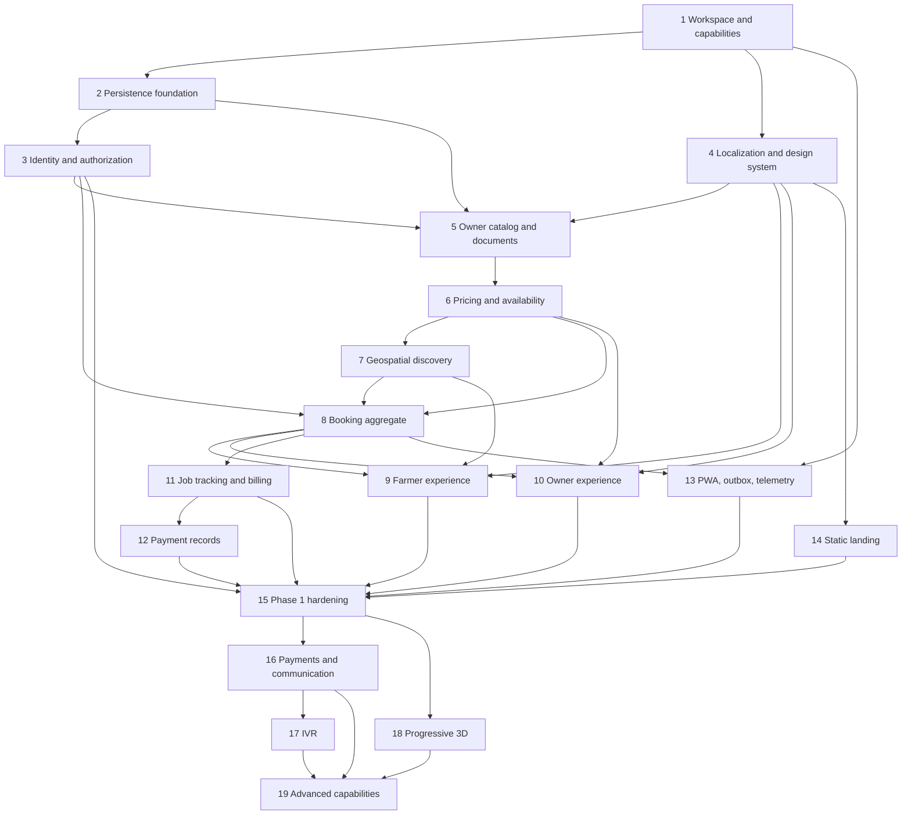

# Implementation Plan

## Overview

This plan implements the design in four capability-gated releases. Phase 1 establishes the complete provider-independent booking, work, billing, cash-record, accessible PWA, and operational foundation; later phases enable configured payments/communications, IVR, and premium 3D/advanced capabilities. Each task references the requirements it satisfies, and correctness properties are implemented alongside the relevant domain behavior.

## Task Dependency Graph



```json
{
  "waves": [
    { "wave": 1, "tasks": ["1"], "dependsOn": [] },
    { "wave": 2, "tasks": ["2", "4"], "dependsOn": [1] },
    { "wave": 3, "tasks": ["3", "14"], "dependsOn": [2] },
    { "wave": 4, "tasks": ["5"], "dependsOn": [3] },
    { "wave": 5, "tasks": ["6"], "dependsOn": [4] },
    { "wave": 6, "tasks": ["7"], "dependsOn": [5] },
    { "wave": 7, "tasks": ["8"], "dependsOn": [6] },
    { "wave": 8, "tasks": ["9", "10", "11", "13"], "dependsOn": [7] },
    { "wave": 9, "tasks": ["12"], "dependsOn": [8] },
    { "wave": 10, "tasks": ["15"], "dependsOn": [9] },
    { "wave": 11, "tasks": ["16", "18"], "dependsOn": [10] },
    { "wave": 12, "tasks": ["17"], "dependsOn": [11] },
    { "wave": 13, "tasks": ["19"], "dependsOn": [12] }
  ]
}
```

Tasks within a numbered group run in subtask order unless their descriptions are independent. A later phase must not enable a live capability until its readiness subtask passes.

## Tasks

### Phase 1: Core Booking Platform

- [x] 1. Establish the workspace, shared contracts, and capability model
  - [x] 1.1 Create the monorepo applications and packages for the responsive web/PWA, shared domain, backend API, database access, provider adapters, localization catalogs, and test utilities.
    - Add repeatable local, test, staging, and production configuration schemas.
    - Pin runtime/tool versions and expose non-secret environment validation at startup.
    - _Requirements: 1.1, 1.3, 18.5_
  - [x] 1.2 Implement the provider capability registry and client-safe capability projection.
    - Represent `UNCONFIGURED`, `SANDBOX`, `LIVE`, and `DEGRADED` states.
    - Reject production use of local OTP codes, unsigned callbacks, fake phone numbers, and test payment success paths.
    - _Requirements: 14.1, 14.2, 14.3, 14.4, 14.5_
  - [x] 1.3 Write property tests for capability honesty.
    - Generate capabilities and environments; verify unconfigured operations have no external effects and sandbox/live labels are truthful.
    - Record seeds and minimized counterexamples in test output.
    - _Requirements: 14.1, 14.2, 14.3, 14.5_

- [x] 2. Build the relational, geospatial, and audit persistence foundation
  - [x] 2.1 Create migrations for users, profiles, roles, locations, tractors, documents, equipment, service offerings, pricing rules, availability, bookings, recipients, status history, work evidence, invoices, payments, provider events, notifications, IVR sessions, idempotency records, audit events, and outbox events.
    - Use integer paise, timezone-aware instants, version columns, append-only history, and foreign keys.
    - _Requirements: 1.1, 6.1, 8.3, 8.10, 9.2, 10.5, 12.3, 12.4_
  - [x] 2.2 Add phone/registration lookup hashes, public reference uniqueness, provider-event uniqueness, idempotency-scope uniqueness, geospatial indexes, bounded-query indexes, and the same-Tractor scheduling exclusion constraint.
    - Use half-open intervals so adjacent bookings remain valid.
    - _Requirements: 7.5, 8.5, 8.6, 8.7, 11.6, 12.3, 18.3_
  - [x] 2.3 Implement transaction helpers, optimistic concurrency, transactional outbox storage, PII-safe audit writing, and test database factories.
    - Ensure domain mutations and required history/outbox records commit atomically.
    - _Requirements: 5.5, 8.10, 12.4, 14.6, 18.1_

- [x] 3. Implement OTP identity, sessions, and default-deny authorization
  - [x] 3.1 Implement phone normalization, hashed expiring OTP challenges, request/attempt throttles, purpose binding, explicit local-development OTP adapter, session issuance/refresh/revocation, and role membership.
    - Make production responses enumeration-resistant.
    - _Requirements: 2.1, 2.2, 2.7, 14.2, 14.5_
  - [x] 3.2 Implement server authorization policies for Farmer bookings, Owner Tractors/assigned bookings, public redacted views, private documents, and future support access.
    - Enforce policy in commands and queries, not only route guards.
    - _Requirements: 2.3, 2.4, 2.5, 2.6, 4.5, 12.2_
  - [x] 3.3 Write property tests for role isolation and redaction.
    - Generate principals, role memberships, ownership graphs, actions, and private entities.
    - Verify unauthorized operations are denied without mutation and projections never leak protected fields.
    - _Requirements: 2.3, 2.4, 2.5, 2.6, 3.4, 4.5, 12.2_

- [x] 4. Create the localization, accessible design system, and role-aware client shell
  - [x] 4.1 Implement translation catalogs and formatting for Telugu, Hindi, English, Kannada, and Tamil with English fallback and missing-key telemetry.
    - Externalize menus, controls, forms, statuses, help, date/time, and Indian currency strings.
    - _Requirements: 13.1, 13.2, 13.3_
  - [x] 4.2 Write property tests for localization fallback completeness.
    - Generate supported locales and registered keys; verify nonempty translations or nonempty English fallback with no raw-key rendering.
    - _Requirements: 13.1, 13.2, 13.3_
  - [x] 4.3 Build green/cream visual tokens and reusable accessible controls, cards, status chips, forms, dialogs, steppers, navigation, empty states, and error states based on the showcase.
    - Enforce target size, contrast, visible focus, keyboard use, icon labels, script-appropriate font fallback, reduced motion, and responsive zoom behavior.
    - _Requirements: 3.1, 3.2, 13.4, 13.5, 13.6, 13.7, 16.1_
  - [x] 4.4 Implement public, Farmer, and Owner route shells with server-authorized loaders and role-specific navigation.
    - Add language selection, onboarding, login, Help, Account, and capability-unavailable surfaces.
    - _Requirements: 2.6, 3.1, 5.1, 13.2, 14.2, 17.1_

- [x] 5. Implement Owner onboarding, Tractor catalog, Equipment, and private documents
  - [x] 5.1 Build Owner profile and multi-Tractor commands, validation, APIs, and screens for identity, operating location, Tractor attributes, photos, and registration data.
    - Encrypt sensitive values and expose only authorized projections.
    - _Requirements: 4.1, 4.2, 4.3, 12.1, 12.2_
  - [x] 5.2 Build Equipment inventory, Tractor assignment, Service Offering management, and eligibility evaluation.
    - Return explicit unmet eligibility reasons and prevent invalid discovery publication.
    - _Requirements: 4.2, 4.3, 4.4_
  - [x] 5.3 Implement private upload grants, metadata persistence, MIME/signature/size validation, scanning state, encrypted object access, and short-lived authorized download grants.
    - Keep the provider unavailable state honest when object storage is not configured.
    - _Requirements: 4.5, 4.6, 12.1, 14.2_
  - [x] 5.4 Add API, component, and accessibility tests for Owner onboarding and catalog workflows.
    - Cover incomplete eligibility, cross-Owner denial, upload rejection, and responsive camera/file input behavior.
    - _Requirements: 4.1, 4.2, 4.3, 4.4, 4.5, 4.6_

- [x] 6. Implement service-specific pricing and operational availability
  - [x] 6.1 Implement Pricing Rule commands and Owner UI for hourly, per-acre, and per-trip rates by Service Offering and Equipment.
    - Require positive paise rates and a disclosed hourly rounding policy.
    - _Requirements: 6.1, 6.2, 6.3_
  - [x] 6.2 Implement active Pricing Rule queries, Farmer-visible method selection, estimate calculation, and immutable Quote Snapshot creation.
    - Version catalog changes and preserve prior booking agreements.
    - _Requirements: 6.4, 6.5, 6.6, 6.7_
  - [x] 6.3 Implement per-Tractor online/offline commands, eligibility rechecks, audit events, and cross-client refresh/realtime projection.
    - Preserve existing confirmed booking controls while excluding new demand.
    - _Requirements: 5.2, 5.3, 5.4, 5.5_
  - [x] 6.4 Write property tests for offline behavior and Quote Snapshot immutability.
    - Generate Tractors, existing bookings, status changes, Pricing Rule versions, and work evidence.
    - Verify offline exclusion/preservation and that later catalog prices never change agreed billing.
    - _Requirements: 5.2, 5.3, 5.4, 6.6, 6.7, 10.6_

- [x] 7. Implement Service Location capture and geospatial discovery
  - [x] 7.1 Implement normalized Location records and manual state/district/mandal-or-taluk/village/landmark entry, consented browser GPS capture, freshness policy, and provider-gated map/geocoding adapters.
    - Communicate denied permission, unavailable maps, coordinate accuracy, and data freshness.
    - _Requirements: 7.1, 7.6, 7.7, 12.6, 14.2, 14.4_
  - [x] 7.2 Implement bounded, cursor-paginated radius search using Service Location, online/eligibility state, Service Offering, Equipment, active pricing, and interval conflicts.
    - Default to configurable 5 km, allow expansion, redact private fields, and sort deterministically.
    - _Requirements: 3.3, 3.4, 7.2, 7.4, 7.5, 7.6, 7.8, 18.3_
  - [x] 7.3 Write property tests for recipient-origin discovery and geospatial radius soundness.
    - Generate customer/Recipient points, candidate Tractors, filters, and radii near geometric boundaries.
    - Verify changing customer location cannot affect someone-else results and every returned Tractor is inside tolerance.
    - _Requirements: 7.2, 7.3, 7.4, 7.5, 8.3_
  - [x] 7.4 Add database integration and performance tests for spatial indexes, broad rural searches, eligibility filters, stable pagination, and stale locations.
    - _Requirements: 7.4, 7.5, 7.8, 18.3, 18.4_

- [x] 8. Implement the booking aggregate and concurrency-safe lifecycle
  - [x] 8.1 Implement self/other booking commands, Recipient snapshots, Service Location snapshots, Quote Snapshots, Farmer-scoped idempotency, and booking-request outbox events.
    - Revalidate all offering, pricing, status, location, and interval inputs in one transaction.
    - _Requirements: 8.1, 8.2, 8.3, 8.4, 8.5_
  - [x] 8.2 Implement Owner accept/reject, Farmer/Owner cancellation policies, atomic interval reservation, optimistic version checks, and conflict responses.
    - Ensure the database and domain layer both prevent overlapping Blocking Bookings.
    - _Requirements: 8.6, 8.7, 8.9, 8.10_
  - [x] 8.3 Implement the complete booking transition table, actor permissions, status history, agreement-change versioning, expiry jobs, and configured notifications.
    - Cover rejected, cancelled, expired, disputed, refund-pending, and refunded outcomes.
    - _Requirements: 8.8, 8.9, 8.10, 8.11, 14.6_
  - [x] 8.4 Write property tests for idempotent creation, no accepted overlap, adjacent intervals, and lifecycle safety.
    - Include concurrent transaction generation and verify losing attempts have no partial state.
    - _Requirements: 8.5, 8.6, 8.7, 8.8, 8.9, 8.10_

- [x] 9. Build the Farmer search and booking experience
  - [x] 9.1 Build Farmer Home, search/filter results, Tractor cards, details, and adjustable-radius empty state using redacted discovery projections.
    - Preserve the showcase's clear cards and accessible primary actions across mobile and desktop.
    - _Requirements: 3.1, 3.2, 3.3, 3.4, 7.4, 7.6_
  - [x] 9.2 Build the resumable booking stepper for target, Recipient, Service Location, work/Equipment, schedule, pricing, and review.
    - Search from Recipient location for someone-else bookings and show all required confirmation fields.
    - _Requirements: 7.3, 8.1, 8.2, 8.3, 8.12_
  - [x] 9.3 Build Farmer booking lists/details for pending, accepted, scheduled, active, completed, cancelled, disputed, invoice, and payment states.
    - Show Owner contact only when policy permits.
    - _Requirements: 2.4, 3.4, 8.8, 10.8, 11.1_
  - [x] 9.4 Add end-to-end and accessibility tests for self-booking and cross-city someone-else booking.
    - Cover manual location, GPS denial, pricing disclosure, duplicate submit, conflict refresh, localization, keyboard, screen reader, zoom, and narrow screens.
    - _Requirements: 3.1, 3.2, 7.1, 7.3, 8.5, 8.12, 13.4, 13.5, 13.7_

- [x] 10. Build the Owner dashboard and booking-management experience
  - [x] 10.1 Build the dashboard with the availability control first, summary cards, Tractor/Equipment/document shortcuts, requests, active jobs, earnings, and payment links.
    - Keep existing booking controls visible while offline.
    - _Requirements: 5.1, 5.2, 5.3, 5.5_
  - [x] 10.2 Build responsive Tractor, Equipment, documents, Pricing & Services, booking request, booking detail, and accepted-job screens.
    - Present requested work, Service Location, quantity, interval, and agreed Quote Snapshot before accept/reject.
    - _Requirements: 4.2, 4.3, 6.2, 6.3, 8.6, 8.12_
  - [x] 10.3 Add end-to-end and accessibility tests for onboarding, eligibility, going online/offline, pricing, accepting/rejecting, and concurrent conflict feedback.
    - _Requirements: 4.4, 5.2, 5.3, 5.4, 6.1, 6.2, 8.6, 13.4_

- [x] 11. Implement job tracking, reproducible billing, and disputes
  - [x] 11.1 Implement idempotent start/pause/resume/complete commands, ordered work-event validation, active-interval folding, per-acre/per-trip measurements, and append-only corrections.
    - Return valid-next-action information for invalid sequences.
    - _Requirements: 9.1, 9.2, 9.3, 9.4, 9.5, 9.6, 9.7_
  - [x] 11.2 Implement proportional-minute and disclosed block rounding, per-acre and per-trip formulas, single-boundary minor-unit rounding, invoice trace persistence, and agreement-version linkage.
    - Add deterministic tests for all PRD example totals.
    - _Requirements: 10.1, 10.2, 10.3, 10.4, 10.5, 10.6, 10.7_
  - [x] 11.3 Build Owner job controls/work-completion/invoice preview and Farmer active-job/final-bill/review/dispute screens.
    - Display evidence, formula, rate, quantity, adjustments, and final total in accessible localized form.
    - _Requirements: 9.1, 9.7, 10.6, 10.8, 13.2, 13.7_
  - [x] 11.4 Write property tests for work-event accounting, proportional hourly billing, acre/trip billing, and correction history.
    - Generate valid and invalid event sequences, rates, minutes, decimal acreage, trips, policies, and agreement versions.
    - _Requirements: 9.1, 9.3, 9.4, 9.7, 10.1, 10.2, 10.3, 10.4, 10.5, 10.7_

- [x] 12. Implement core payment records and audited cash settlement
  - [x] 12.1 Implement payment and payment-event aggregates, invoice application rules, statuses, overpayment prevention, refunds state placeholders, and authorized receipt projection.
    - Keep Provider Capability handling separate from domain settlement rules.
    - _Requirements: 11.1, 11.7, 11.8, 12.4_
  - [x] 12.2 Implement audited cash recording with recorder, timestamp, amount checks, Farmer/Owner views, and completion transition.
    - Never reuse online-paid status for cash.
    - _Requirements: 11.2, 11.7, 11.8_
  - [x] 12.3 Write property tests for invoice-payment conservation and payment-method integrity.
    - Generate invoices, partial/full payments, cash records, refunds, and repeated commands.
    - _Requirements: 11.2, 11.7_

- [x] 13. Implement safe PWA connectivity, outbox processing, and operational telemetry
  - [x] 13.1 Configure service workers and caching rules for shell assets, public static assets, and translation catalogs while excluding tokens, private documents, payment responses, and sensitive booking data.
    - Keep core browser flows functional without installation or push permission.
    - _Requirements: 17.1, 17.2, 17.5_
  - [x] 13.2 Implement freshness indicators, safe draft storage, explicit retry with stable idempotency keys, and no-silent-queue behavior for Authoritative Actions.
    - Test intermittent connectivity and stale availability/quote/invoice/payment data.
    - _Requirements: 3.5, 17.3, 17.4_
  - [x] 13.3 Implement the outbox worker abstraction, notification records, retry/backoff, dead-letter handling, localized template contracts, and provider-independent delivery status.
    - Notification delivery SHALL never determine domain transaction success.
    - _Requirements: 14.6, 17.6_
  - [x] 13.4 Add PII-redacted structured logs, metrics, traces, correlation IDs, dashboards, and alerts for the defined operational indicators.
    - _Requirements: 12.7, 18.1, 18.2_

- [x] 14. Deliver the accessible static public landing experience
  - [x] 14.1 Build the Phase 1 landing page from the showcase with hero, how it works, services, Owner benefits, pricing, phone-booking capability state, languages, final CTA, and footer.
    - Use optimized Indian agricultural imagery and preserve green/cream identity on mobile and desktop.
    - _Requirements: 16.1, 16.2, 16.3_
  - [x] 14.2 Implement static/reduced-motion fallbacks and capability-aware copy that never displays a fabricated IVR number or unavailable provider as live.
    - _Requirements: 13.6, 14.2, 15.8, 16.3, 16.5_
  - [x] 14.3 Add responsive, accessibility, metadata, link, and web-vital tests for representative low-end mobile and desktop profiles.
    - _Requirements: 13.4, 13.5, 13.6, 16.6, 17.1_

- [x] 15. Harden and release the Phase 1 vertical slice
  - [x] 15.1 Complete end-to-end tests from OTP sandbox through Owner catalog, search, self/other booking, acceptance, work, invoice, dispute, cash record, history, and receipt.
    - Verify shared authoritative state across Farmer and Owner clients.
    - _Requirements: 1.1, 1.2, 1.3, 8.8, 11.8_
  - [x] 15.2 Execute security tests for OTP abuse, cross-role/object access, uploads, signed grants, injection, session revocation, location/contact exposure, booking races, invoice tampering, and PII-safe logs.
    - _Requirements: 2.1, 2.3, 4.5, 4.6, 8.6, 12.1, 12.2, 12.3, 12.6_
  - [x] 15.3 Run load and performance tests for indexed discovery, dashboard pagination, concurrent acceptance, API latency targets, responsive assets, and web vitals; tune and document the initial load profile.
    - _Requirements: 16.6, 17.1, 18.3, 18.4_
  - [x] 15.4 Test additive migrations, seeded stable identifiers, backup restore, account deletion/anonymization, monitoring alerts, capability rollback, and production readiness checklist.
    - _Requirements: 12.5, 12.7, 18.5, 18.7_

### Phase 2: Payments and Communication

- [x] 16. Integrate verified online payments, communications, and support
  - [x] 16.1 Select and implement a payment adapter with sandbox/live capability gates, server-created intents, signed webhook verification, amount/currency/reference checks, immutable events, and provider-event deduplication.
    - Browser redirects must remain non-authoritative.
    - _Requirements: 1.4, 11.3, 11.4, 11.5, 11.6, 14.1, 14.3_
  - [x] 16.2 Implement online receipt and refund flows, pending/failure recovery, reconciliation jobs, and authorized Farmer/Owner payment history.
    - _Requirements: 11.1, 11.7, 11.8, 12.4_
  - [x] 16.3 Write property tests for payment trust and provider-event deduplication.
    - Generate valid/invalid signatures, duplicates, out-of-order events, amount/currency mismatches, and browser redirects.
    - _Requirements: 11.4, 11.5, 11.6_
  - [x] 16.4 Integrate configured SMS/push adapters, consent-aware Owner contact sharing, booking/receipt templates, delivery telemetry, and degraded-provider recovery.
    - _Requirements: 1.4, 3.4, 14.4, 14.6, 17.6_
  - [x] 16.5 Build support/dispute resolution workflows and expand verified regional translations.
    - _Requirements: 1.4, 10.8, 13.1, 13.2_
  - [x] 16.6 Run provider contract, sandbox, security, failure-mode, reconciliation, rollback, and launch-readiness tests before enabling each live capability.
    - _Requirements: 14.5, 18.7_

### Phase 3: Keypad-Phone Booking

- [x] 17. Integrate the IVR channel through the shared domain
  - [x] 17.1 Select a telephony provider and configure an environment-specific dedicated number, signed callback validation, capability gates, call-session storage, and PII-safe call telemetry.
    - Keep the public number hidden until live readiness passes.
    - _Requirements: 1.5, 14.1, 14.5, 15.1, 15.8_
  - [x] 17.2 Implement versioned localized prompt trees for language, verification, saved/manual location, service, date/time, quantity, confirmation, and booking status.
    - Add bounded retries, repeat/help, timeout handling, and configured assisted transfer.
    - _Requirements: 15.2, 15.3, 15.4_
  - [x] 17.3 Connect IVR commands to shared discovery, Quote Snapshot, booking, idempotency, status, and notification services.
    - Require caller verification before existing-booking access or mutation.
    - _Requirements: 1.1, 1.2, 15.3, 15.5, 15.6, 15.7_
  - [x] 17.4 Add transcript-driven integration tests for all languages, invalid digits, retries/timeouts, identity failure, no-result search, duplicate submission, assisted fallback, confirmation, and cross-channel visibility.
    - _Requirements: 1.2, 15.2, 15.3, 15.4, 15.5, 15.6, 15.7_
  - [x] 17.5 Complete telephony security, reliability, operational, rollback, and end-to-end readiness checks before exposing the number.
    - _Requirements: 1.5, 15.8, 18.2, 18.7_

### Phase 4: Premium Landing and Improvements

- [x] 18. Add progressive 3D without coupling it to booking
  - [x] 18.1 Implement a separately lazy-loaded tractor scene with compressed model/textures, scroll-linked subtle motion, timeout handling, and a static poster fallback.
    - Do not include the 3D runtime in booking routes.
    - _Requirements: 1.6, 16.4, 16.5, 16.7_
  - [x] 18.2 Implement capability checks for reduced motion, data saver, device memory/GPU confidence, disabled scripting, and load failure.
    - Preserve identical essential content and primary links across every fallback path.
    - _Requirements: 13.6, 16.5_
  - [x] 18.3 Write property tests for 3D independence.
    - Generate disabled, failed, timed-out, and loaded outcomes; verify essential content and booking/Owner links remain operable.
    - _Requirements: 16.3, 16.4, 16.5_
  - [x] 18.4 Enforce the compressed model and web-vital budgets in continuous integration and measure fallback rate in production telemetry.
    - _Requirements: 16.6, 16.7, 18.2_

- [x] 19. Add advanced discovery, analytics, reporting, and scale safeguards
  - [x] 19.1 Add provider-backed map enhancements and advanced search only through existing location/discovery contracts and capability states.
    - Preserve manual location and radius semantics.
    - _Requirements: 1.6, 7.1, 7.2, 7.7, 14.1_
  - [x] 19.2 Add privacy-reviewed product analytics and advanced Owner earnings reports derived from existing invoice/payment records.
    - Do not create a second financial source of truth.
    - _Requirements: 1.6, 11.7, 12.2, 18.2_
  - [x] 19.3 Expand languages and execute full regression, accessibility, property, performance, security, migration, backup, and provider readiness suites.
    - _Requirements: 1.6, 13.1, 13.3, 13.4, 18.5, 18.7_
  - [x] 19.4 Document extraction criteria for future modules and prove that versioned contracts, outbox delivery, reconciliation, and rollback preserve booking/invoice/payment invariants before any service split.
    - _Requirements: 18.5, 18.6_

## Notes

- Property-based test tasks implement the eighteen correctness properties in `design.md`; they remain incomplete until the named test suite has been executed successfully.
- Provider-backed tasks must use explicit sandbox credentials during testing and remain capability-gated until production readiness is approved.
- No task may substitute client-side checks for server authorization, booking concurrency controls, billing calculations, or payment verification.
- Phase 4 visual enhancement work must preserve the static and reduced-motion paths and may not regress core booking performance.
